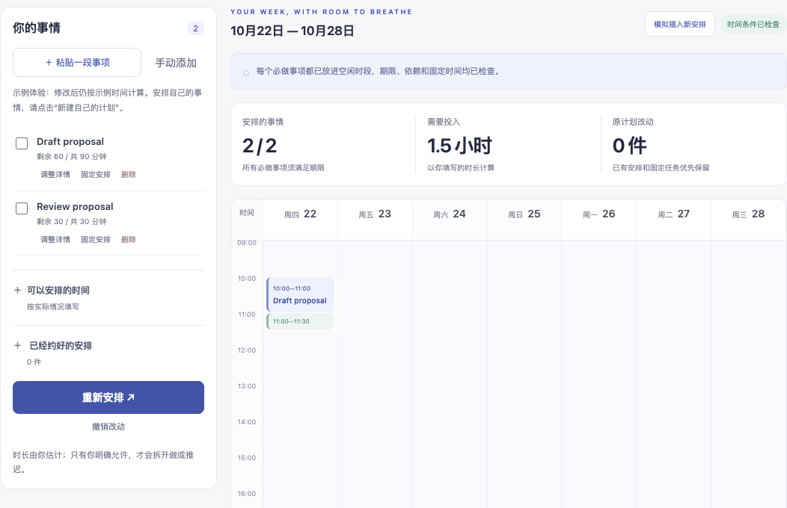

# DayWeave

Put tasks into the hours you actually have. When they don't fit, see what needs to change.

[中文](README.zh-CN.md) · [Usage](docs/usage.md) · [v0.2.2 prerelease](https://github.com/crown-sports/dayweave/releases/tag/v0.2.2)



*Actual local planner with editable demo tasks. Completed work is entered by the user.*

Add your tasks, estimated durations, deadlines and appointments. DayWeave makes
a timetable, explains conflicts, and tries to keep existing arrangements when
something changes. Export the result to your calendar as `.ics`.

## Open it

Install **Python 3.12** from [python.org](https://www.python.org/downloads/), then
download and unzip **Source code (zip)** from [v0.2.2](https://github.com/crown-sports/dayweave/releases/tag/v0.2.2).

- Windows: double-click `Start-DayWeave.cmd`.
- macOS: double-click `Start-DayWeave.command`.
- Linux or terminal: run `python3 launch.py`.

The first launch installs dependencies and needs internet. The planner opens at
**http://127.0.0.1:8787**. Keep the terminal open while using it. No account or model is needed.

## Try a day before entering your week

The browser UI is Chinese:

1. Choose **简单排序排不了的一天** under **先体验一下** and click **载入示例**.
2. Click **安排这一周**. Both tasks fit: study **09:00–12:00**, phone call **12:00–13:00**.
3. Try **事情比时间多的上午** to see what happens when 240 minutes of work have only 180 minutes available.


*Built-in overload example. The proposed postponement takes effect only after you accept it.*

## Make your own plan

Click **新建自己的计划**, add tasks, and set realistic durations and deadlines.
Edit your available hours and import an `.ics` file or enter appointments.
Click **安排这一周**, then inspect the blocks or adjust a conflicting commitment.

Partway through a task? Open **调整详情** and enter **已完成工时（分钟，累计）**.
A 90-minute task with 30 minutes done needs 60 more minutes. Replan to schedule
only that work. Pin a task when its time must stay fixed.

**保存项目** downloads a JSON backup; **打开项目** restores it. **导出到日历**
downloads an `.ics` file for you to import. Nothing is written to a connected calendar.

## For CLI users

From the downloaded source directory:

```sh
python3 -m venv .venv
source .venv/bin/activate
python -m pip install .
dayweave plan examples/partial-progress.json --output remaining.json --calendar remaining.ics
```

The sample produces a checked **60-minute draft + 30-minute review**. On Windows,
activate `.venv\Scripts\Activate.ps1` and use `.venv\Scripts\python.exe`.
[JSON format, calendar support and optional local models](docs/usage.md).

## A few limits

This is a local, single-person planner. Durations are your estimates; it does not
track work automatically or send reminders. Browser data needs a saved backup
before you clear it. Some plans can time out, and not every calendar recurrence
is supported. [What to change when a plan doesn't fit](docs/product.md).

The scheduler uses OR-Tools CP-SAT and checks results independently. In published
synthetic tests it completed 48/48 feasible cases versus 34/48 for deadline-based
insertion. These are scheduling fixtures, not measured productivity gains.
[Algorithms and full results](docs/results.md) · [Design](docs/design.md) · [Licenses](NOTICE)
