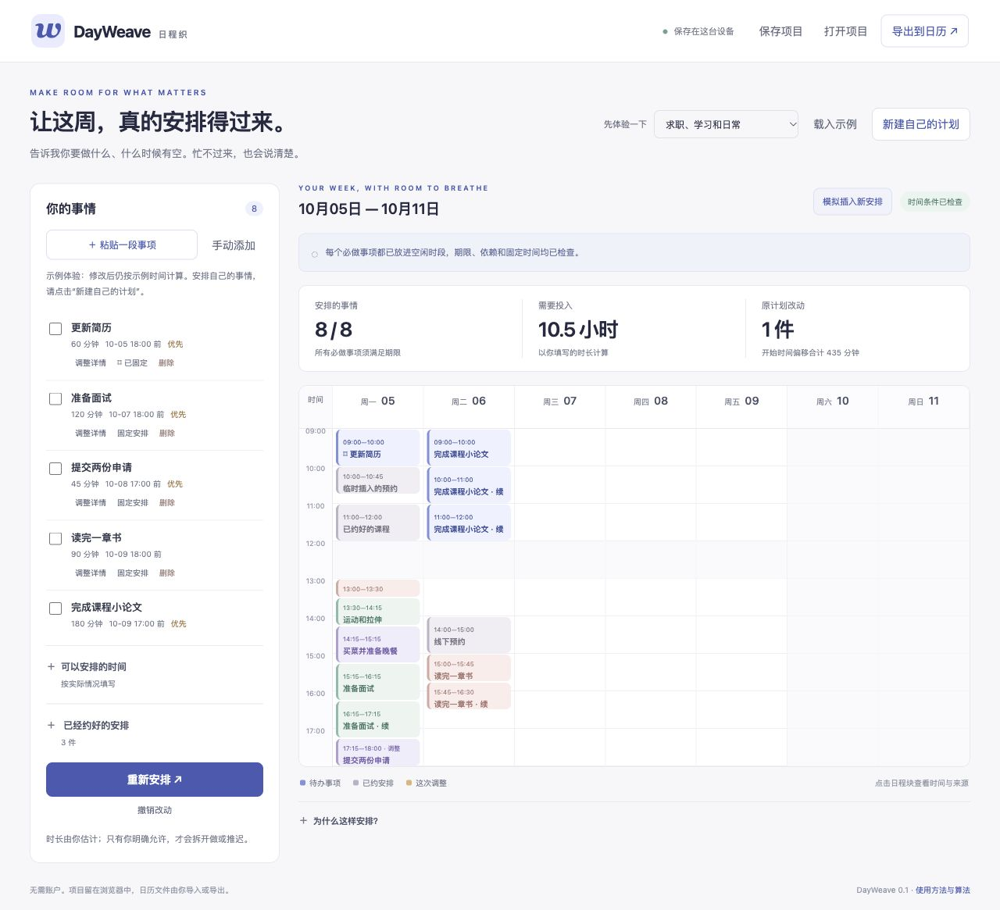
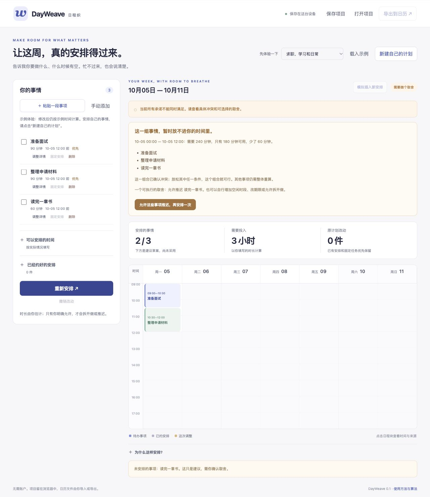

# DayWeave · 日程织

当前版本 **0.2.0（预发布）**，通过 [GitHub Releases](https://github.com/crown-sports/dayweave/releases/tag/v0.2.0) 提供 wheel、源码归档和 `SHA256SUMS`；不依赖 PyPI 发布。安装说明固定到此版本。

**把待办和已有日历，排成真的放得下的日程；排不下会解释，临时有事会尽量少改。**

[English](README.md) · [算法说明](docs/algorithms.md) · [完整实测与原始记录](docs/results.md)

## 解决什么问题

你知道自己要准备面试、交作业、读书、办理预约，但清单不会告诉你：
这些事情能不能在截止时间前完成？临时多一个预约，是否必须把一周全部重排？
忙不过来时，究竟是哪几件事冲突、差多少时间？

DayWeave 面向个人求职、学习和日常安排。你填写事情、预计时长、期限和空闲时间，
再导入已经约好的日历；它计算可行日程，给出冲突解释，支持你确认取舍后重新安排。



## 输入、输出是什么

| 你提供的输入 | 得到的输出 |
| --- | --- |
| 每件事和预计时长，例如准备面试 90 分钟 | 放进实际空闲时段的日程块 |
| 什么时候才能开始、最晚什么时候完成 | 检查开始时间与截止期限 |
| 哪件事必须先做、哪些时间不可改 | 满足先后关系和固定安排 |
| 哪些事项允许拆开做、允许推迟 | 保留完整时长，明确列出未安排事项 |
| 原来的安排和新插入的预约 | 尽量少改原计划，标出调整了哪些事 |

例如，上午只有 3 小时，但三件必做事项需要 90、90、60 分钟。
程序会显示：**需要 240 分钟，可用 180 分钟，少了 60 分钟**。
它会展示具体冲突，并建议一个可行取舍。只有你点击允许推迟，才会采用该选择。



## 别人如何使用

先从 [python.org](https://www.python.org/downloads/) 安装 **Python 3.12**。
在 [v0.2.0 GitHub 预发布页](https://github.com/crown-sports/dayweave/releases/tag/v0.2.0)下载 **Source code (zip)**，解压后：

- Windows：双击 `Start-DayWeave.cmd`。
- macOS：双击 `Start-DayWeave.command`。
- Linux 或终端：执行 `python3 launch.py`。

首次启动会安装依赖，需要联网；依赖放在项目自己的 `.venv` 里。
后续启动会复用这个环境。浏览器会打开 `http://127.0.0.1:8787`。
使用时保持启动窗口开启，退出时按 Ctrl+C。**核心排程无需账户、API Key、模型或显卡。**

1. 点击 **新建自己的计划**。示例用于体验，编辑示例仍按示例时间计算；自己的计划会考虑当前时间。
2. 点击 **粘贴一段事项** 或 **手动添加**。推荐一行一件事：

   ```text
   准备面试 | 90分钟 | 周五18:00前
   读完一章书 | 半小时 | 周日18:00前
   买菜
   ```

3. 原文没有给出的时长或完整期限会留空。填写你的估计，或明确确认“以本周结束为目标”。
   可以取消勾选不想加入的事项。
4. 展开 **可以安排的时间**，按自己的生活填写；展开 **已经约好的安排**，导入 `.ics` 或手动添加预约。
5. 点击 **安排这一周**。有冲突时增加空闲时间、调整期限、允许拆分，或确认推迟某些事项。
6. 点击日程块查看详情。需要保留时点的事项可以 **固定安排**；增加预约后重新计算。
7. **导出到日历** 会下载 `.ics`，由你导入常用日历。**保存项目** 会下载 JSON 备份；
   以后用 **打开项目** 恢复。恢复后会重新检查，避免把旧结果直接当成当前有效日程。

## 技术体现在哪里

排程使用成熟的 [OR-Tools CP-SAT](https://developers.google.com/optimization/cp/cp_solver)。
本项目没有把它包装成“自研新算法”。具体实现与验证包括：

- **约束调度**：时长、空闲窗口、期限、先后关系、预约、不重叠和固定时间都是约束。
  拆分后的多个时段共享任务选择状态，避免把只做了一半的事项算成已安排。
- **尽量少改的重排**：先满足必做事项并最大化已安排事项的重要度总分，再依次减少
  改动事项数、开始时间偏移、完成时间与拆分间隔。每一步记录是否证明最优。
- **解释排不下的原因**：对已证明不可行的输入提取冲突组，逐项检查能否简化。
  当时长超出容量时，单独计算时间缺口。没有完成证明时会明确说明。
- **独立复核**：另一个不使用求解器的检查器校验每段时长、时间窗口、期限、依赖和重叠；
  导出时再次检查。小案例用逐分钟穷举核对可行性与优化结果。
- **可核对的输入整理**：明确的竖线格式走规则解析。可选本地模型负责从自由文字选取原文，
  不补写未给出的时长和期限，整理失败会显示回退结果。原文存在不代表语义一定正确，仍需人确认。

工程贡献是把这些技术接成可使用、可解释、可验证的个人工具。技术难点集中在组合约束、
稳定重排、冲突解释与输入可靠性；不是新增聊天接口或渲染一张静态日历。

## 实测效果和边界

| 同一输入的对照实验 | DayWeave | 截止日期插入或保留后重建基线 |
| --- | --- | --- |
| 48 个带时间窗口和期限的可行生成案例，完整排下 | 48 / 48 | 34 / 48 |
| 32 个期限受限的重排案例，完整排下 | 32 / 32 | 32 / 32 |
| 上述 32 例平均改动事项数 | 2 | 9.125 |
| 96 个小案例，与独立穷举核对可行性和前三个优化目标 | 96 / 96 一致 | 不以基线作为正确答案 |

这些是公开的自建案例；在时间宽松的重排案例上，保留原安排的基线也能达到只改一件事。
不能据此宣称真实用户效率提高了某个百分比，也没有与商业排程工具作实测比较。
Linux、RTX 5090 的模型输出、失败情况、源代码指纹和全部原始记录见 [实测报告](docs/results.md)。

当前是本地单人使用的首个预发布版本。项目保存在浏览器；计算在本机进程中进行；下载内容
最多在内存中保留五分钟。没有直接写入联网日历、提醒通知、多人协作、习惯追踪或路程时间估计。
日历中标为透明的事件不会占用时间；重叠的忙碌预约会被视为需要处理的冲突。
程序不会自行标记你已经完成事项，也不能保证实际执行一定符合预计时长。

## 开发者

```sh
python3 -m venv .venv
.venv/bin/python -m pip install '.[dev]'
.venv/bin/dayweave serve
```

JSON 接口、模型配置、日历支持范围见 [使用指南](docs/usage.md)，算法细节见
[算法说明](docs/algorithms.md)，开发顺序与验收标准见 [设计文档](docs/design.md)。
DayWeave 本身采用 MIT；外部依赖独立安装，许可证说明见 [NOTICE](NOTICE)。
